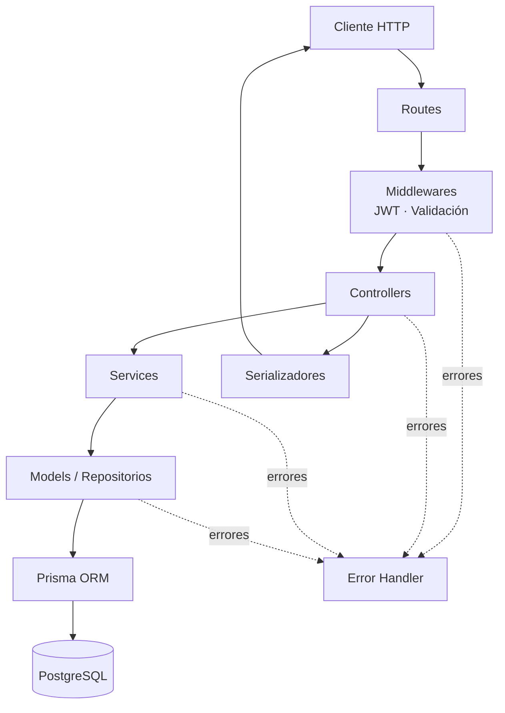
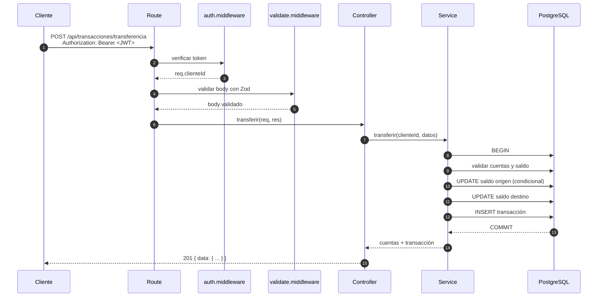

# 🏗️ Arquitectura

Documento de diseño del sistema bancario. Explica cómo está organizado el código, cuáles son las responsabilidades de cada capa y por qué se tomaron las decisiones principales.

---

## 1. Objetivo

Construir una API REST mantenible que:

- Separe claramente presentación, lógica de negocio y acceso a datos.
- Garantice la integridad del dinero ante operaciones concurrentes.
- Sea fácil de documentar, probar y operar.

## 2. Visión general

El sistema sigue el patrón **MVC** enriquecido con una **capa de servicios**:

- **Model (Modelo):** esquema Prisma y repositorios que encapsulan el acceso a datos.
- **View (Vista):** representación JSON de los recursos, con serializadores que controlan qué se expone.
- **Controller (Controlador):** traduce HTTP ↔ dominio: recibe la request, invoca el servicio y devuelve la respuesta.
- **Service (Servicio):** concentra las reglas de negocio y las operaciones atómicas.

Esta variante es el estándar de facto en aplicaciones Express: mantiene los controladores delgados y evita duplicar reglas de negocio entre endpoints.

## 3. Diagrama de capas



## 4. Responsabilidades por capa

| Capa          | Ubicación          | Responsabilidad                            | No debe hacer               |
| ------------- | ------------------ | ------------------------------------------ | --------------------------- |
| Rutas         | `src/routes/`      | Declarar endpoints y encadenar middlewares | Lógica de negocio           |
| Middlewares   | `src/middlewares/` | Autenticar, validar, manejar errores       | Acceder a la base           |
| Controladores | `src/controllers/` | Orquestar request → servicio → response    | Consultas Prisma directas   |
| Servicios     | `src/services/`    | Reglas de negocio y transacciones          | Conocer `req`/`res`         |
| Modelos       | `src/models/`      | Consultas y escrituras con Prisma          | Reglas de negocio complejas |
| Validadores   | `src/validators/`  | Definir contratos de entrada con Zod       | Acceder a la base           |
| Utilidades    | `src/utils/`       | Errores, JWT, serialización, helpers       | Estado global mutable       |
| Configuración | `src/config/`      | Variables de entorno y OpenAPI             | Lógica de negocio           |

## 5. Estructura de carpetas

```text
src/
├── config/
│   ├── env.ts                 # Validación de process.env con Zod
│   └── swagger.ts             # Especificación OpenAPI 3.0
├── lib/
│   └── prisma.ts              # Singleton de PrismaClient
├── models/
│   ├── cliente.model.ts
│   ├── cuenta.model.ts
│   └── transaccion.model.ts
├── controllers/
│   ├── auth.controller.ts
│   ├── cliente.controller.ts
│   ├── cuenta.controller.ts
│   └── transaccion.controller.ts
├── services/
│   ├── auth.service.ts
│   ├── cuenta.service.ts
│   └── transaccion.service.ts
├── routes/
│   ├── index.ts               # Router principal montado en /api
│   ├── health.route.ts        # /health
│   ├── auth.routes.ts
│   ├── clientes.routes.ts
│   ├── cuentas.routes.ts
│   └── transacciones.routes.ts
├── middlewares/
│   ├── auth.middleware.ts
│   ├── validate.middleware.ts
│   └── error.middleware.ts
├── validators/
│   ├── common.validator.ts
│   ├── auth.validator.ts
│   ├── cuenta.validator.ts
│   └── transaccion.validator.ts
├── types/
│   ├── express.d.ts           # Extiende Request con clienteId
│   └── filtros.ts
├── utils/
│   ├── ApiError.ts
│   ├── asyncHandler.ts
│   ├── jwt.ts
│   └── serializers.ts
├── app.ts                     # Configuración de Express
└── server.ts                  # Arranque y cierre ordenado
```

## 6. Flujo de una petición

Ejemplo: `POST /api/transacciones/transferencia`.



Si cualquier validación falla dentro de la transacción, Prisma ejecuta **ROLLBACK** y no se modifica ningún saldo.

## 7. Transferencia atómica y concurrencia

La transferencia se ejecuta dentro de `prisma.$transaction`. El débito no se hace con un `UPDATE` ciego, sino con una actualización condicional:

```ts
where: { id, estado: 'ACTIVA', saldo: { gte: monto } }
data:  { saldo: { decrement: monto } }
```

Esto aporta dos garantías:

1. **No hay saldos negativos:** si el saldo cambió entre la lectura y la escritura, la condición falla y no se actualiza.
2. **No hay doble gasto:** PostgreSQL serializa las escrituras sobre la misma fila; solo la cantidad de operaciones que el saldo permite tiene éxito.

El script `scripts/smoke.mjs` verifica este comportamiento disparando 10 retiros simultáneos de 200 sobre un saldo de 1000: exactamente 5 tienen éxito y el saldo final es 0.

Los montos se almacenan como `Decimal(14, 2)` y se operan con `Prisma.Decimal` para evitar errores de punto flotante. En la respuesta JSON se convierten a `number`.

## 8. Manejo de errores

Todos los errores se centralizan en `error.middleware.ts` y se traducen a un formato uniforme:

```json
{
  "error": {
    "message": "Saldo insuficiente",
    "details": null
  }
}
```

| Origen                     | Traducción                          |
| -------------------------- | ----------------------------------- |
| `ApiError`                 | Su `statusCode` y mensaje           |
| `ZodError`                 | `400` con detalles de validación    |
| Prisma `P2002` (unique)    | `409` conflicto                     |
| Prisma `P2025` (not found) | `404` no encontrado                 |
| Error inesperado           | `500` sin filtrar detalles internos |

Los controladores se envuelven con `asyncHandler` para que cualquier promesa rechazada llegue al middleware de errores.

## 9. Autenticación y autorización

- **Autenticación:** `POST /api/auth/login` verifica la contraseña con bcrypt y firma un JWT con `sub = clienteId` y vencimiento configurable.
- **Transporte:** header `Authorization: Bearer <token>`.
- **Autorización:** el middleware `autenticar` setea `req.clienteId`. Cada servicio verifica que el recurso pertenezca a ese cliente antes de operar; si no, responde `403`.
- **Estado:** JWT es _stateless_; no hay sesiones en servidor. Para revocar tokens habría que agregar una lista negra o versionado de tokens.

## 10. Decisiones de diseño

| Decisión                           | Motivo                                                                 | Alternativa descartada           |
| ---------------------------------- | ---------------------------------------------------------------------- | -------------------------------- |
| MVC + capa de servicios            | Controladores delgados y reglas reutilizables                          | Lógica en controladores          |
| Repositorios (`models/`)           | Aislar Prisma y poder usar la misma consulta dentro de una transacción | Consultas dispersas en servicios |
| `Decimal` para dinero              | Precisión exacta                                                       | `float`/`double`                 |
| Actualización condicional de saldo | Evita condiciones de carrera sin locks manuales                        | Leer → calcular → escribir       |
| JWT                                | Simple, escalable y sin estado                                         | Sesiones con Redis               |
| Zod                                | Validación declarativa y mensajes claros                               | Validación manual                |
| OpenAPI programático               | Un solo archivo versionado, sin comentarios dispersos                  | `swagger-jsdoc` con anotaciones  |
| Singleton de Prisma                | Un pool de conexiones por proceso                                      | Nueva conexión por request       |
| `helmet` sin CSP                   | Compatibilidad con Swagger UI                                          | CSP estricta (rompe `/docs`)     |

## 11. Configuración y ciclo de vida

- `src/config/env.ts` valida las variables de entorno al arrancar. Si falta una obligatoria, el proceso termina con un mensaje explícito.
- `src/app.ts` construye la aplicación Express (middlewares globales, rutas, Swagger, 404 y error handler).
- `src/server.ts` inicia el servidor y registra manejadores de `SIGINT`/`SIGTERM` para cerrar conexiones ordenadamente.

## 12. Posibles mejoras

- Roles (cliente, cajero, administrador) y permisos granulares.
- Idempotency keys para evitar transferencias duplicadas por reintentos.
- Rate limiting y bloqueo temporal tras intentos fallidos de login.
- Auditoría de accesos y cambios.
- Pruebas automatizadas (unitarias de servicios e integración de endpoints).
- Paginación por cursor y reportes.
- Observabilidad: logs estructurados, métricas y trazas.
