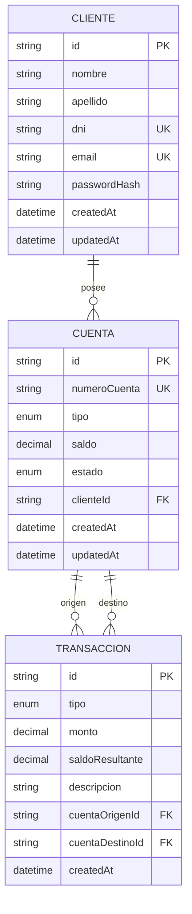

# 🗄️ Modelo de datos

Documento del modelo relacional del sistema bancario, sus reglas de integridad y la forma en que se versiona.

---

## 1. Diagrama entidad-relación



## 2. Entidades

### 2.1 `clientes` — `Cliente`

Persona titular de una o más cuentas.

| Campo          | Tipo       | Restricciones      | Descripción                   |
| -------------- | ---------- | ------------------ | ----------------------------- |
| `id`           | `String`   | PK, `cuid()`       | Identificador interno         |
| `nombre`       | `String`   | obligatorio        | Nombre                        |
| `apellido`     | `String`   | obligatorio        | Apellido                      |
| `dni`          | `String`   | único, 7–9 dígitos | Documento                     |
| `email`        | `String`   | único              | Usuario de login              |
| `passwordHash` | `String`   | obligatorio        | Hash bcrypt (nunca se expone) |
| `createdAt`    | `DateTime` | default `now()`    | Alta                          |
| `updatedAt`    | `DateTime` | `@updatedAt`       | Última modificación           |

### 2.2 `cuentas` — `Cuenta`

Cuenta bancaria asociada a un cliente.

| Campo          | Tipo            | Restricciones                           | Descripción              |
| -------------- | --------------- | --------------------------------------- | ------------------------ |
| `id`           | `String`        | PK, `cuid()`                            | Identificador interno    |
| `numeroCuenta` | `String`        | único, 10 dígitos                       | Número visible de cuenta |
| `tipo`         | `TipoCuenta`    | enum                                    | `AHORRO` o `CORRIENTE`   |
| `saldo`        | `Decimal(14,2)` | default `0`                             | Saldo disponible         |
| `estado`       | `EstadoCuenta`  | enum, default `ACTIVA`                  | `ACTIVA` o `BLOQUEADA`   |
| `clienteId`    | `String`        | FK → `clientes.id`, `onDelete: Cascade` | Titular                  |
| `createdAt`    | `DateTime`      | default `now()`                         | Alta                     |
| `updatedAt`    | `DateTime`      | `@updatedAt`                            | Última modificación      |

### 2.3 `transacciones` — `Transaccion`

Registro inmutable de un movimiento monetario.

| Campo             | Tipo              | Restricciones                | Descripción                                                            |
| ----------------- | ----------------- | ---------------------------- | ---------------------------------------------------------------------- |
| `id`              | `String`          | PK, `cuid()`                 | Identificador interno                                                  |
| `tipo`            | `TipoTransaccion` | enum                         | `DEPOSITO`, `RETIRO`, `TRANSFERENCIA`                                  |
| `monto`           | `Decimal(14,2)`   | > 0 (validación de app)      | Monto operado                                                          |
| `saldoResultante` | `Decimal(14,2)`   | obligatorio                  | Saldo de la cuenta de origen (o destino en depósito) tras la operación |
| `descripcion`     | `String?`         | máx. 200 (validación de app) | Detalle libre                                                          |
| `cuentaOrigenId`  | `String?`         | FK → `cuentas.id`            | Origen (retiro/transferencia)                                          |
| `cuentaDestinoId` | `String?`         | FK → `cuentas.id`            | Destino (depósito/transferencia)                                       |
| `createdAt`       | `DateTime`        | default `now()`              | Fecha de la operación                                                  |

Uso de las referencias según el tipo:

| Tipo            | `cuentaOrigenId` | `cuentaDestinoId` |
| --------------- | ---------------- | ----------------- |
| `DEPOSITO`      | —                | cuenta acreditada |
| `RETIRO`        | cuenta debitada  | —                 |
| `TRANSFERENCIA` | cuenta debitada  | cuenta acreditada |

## 3. Enumeraciones

```prisma
enum TipoCuenta        { AHORRO, CORRIENTE }
enum EstadoCuenta      { ACTIVA, BLOQUEADA }
enum TipoTransaccion   { DEPOSITO, RETIRO, TRANSFERENCIA }
```

## 4. Relaciones

| Relación                           | Cardinalidad | Regla de borrado                                    |
| ---------------------------------- | ------------ | --------------------------------------------------- |
| `Cliente` → `Cuenta`               | 1 : N        | `Cascade` (borrar cliente borra sus cuentas)        |
| `Cuenta` → `Transaccion` (origen)  | 1 : N        | `Restrict` (no se borra una cuenta con movimientos) |
| `Cuenta` → `Transaccion` (destino) | 1 : N        | `Restrict`                                          |

## 5. Reglas de integridad

A nivel de base de datos:

- `clientes.dni` y `clientes.email` son únicos.
- `cuentas.numeroCuenta` es único.
- Las claves foráneas garantizan que una cuenta pertenezca a un cliente existente y que una transacción referencie cuentas existentes.

A nivel de aplicación (`services/`):

- `monto > 0` y como máximo 2 decimales.
- No se permite saldo negativo (actualización condicional `saldo >= monto`).
- Las cuentas `BLOQUEADA` no aceptan operaciones.
- No se puede transferir a la misma cuenta.
- El cliente autenticado solo opera sus propias cuentas.
- `descripcion` tiene un máximo de 200 caracteres.

> **Mejora posible:** agregar un `CHECK (saldo >= 0)` en `cuentas` como defensa adicional a nivel de base. Hoy la garantía está en la capa de servicios mediante `UPDATE ... WHERE saldo >= monto`.

## 6. Índices

| Tabla           | Índice                 | Motivo                       |
| --------------- | ---------------------- | ---------------------------- |
| `clientes`      | `email` (único)        | Login y unicidad             |
| `clientes`      | `dni` (único)          | Unicidad                     |
| `cuentas`       | `numeroCuenta` (único) | Búsqueda y unicidad          |
| `cuentas`       | `clienteId`            | Listar cuentas de un cliente |
| `transacciones` | `cuentaOrigenId`       | Historial por cuenta         |
| `transacciones` | `cuentaDestinoId`      | Historial por cuenta         |
| `transacciones` | `createdAt`            | Filtros y orden por fecha    |

## 7. Dinero y precisión

Los montos usan `Decimal(14,2)`:

- Hasta 12 dígitos enteros y 2 decimales.
- Se operan con `Prisma.Decimal` (librería decimal.js), no con `number`.
- En las respuestas JSON se exponen como `number` por comodidad del cliente.

Esto evita errores como `0.1 + 0.2 = 0.30000000000000004`, inaceptables en un sistema financiero.

## 8. Migraciones

Las migraciones viven en `prisma/migrations/` y están versionadas en el repositorio.

```bash
# Desarrollo: crea una migración a partir de cambios en schema.prisma
pnpm prisma:migrate --name descripcion_del_cambio

# Producción: aplica migraciones pendientes sin crear nuevas
pnpm prisma:deploy

# Desarrollo: reinicia la base y reaplica todo (borra datos)
pnpm prisma:reset
```

Flujo recomendado:

1. Editar `prisma/schema.prisma`.
2. Ejecutar `pnpm prisma:migrate --name cambio`.
3. Revisar el SQL generado en `prisma/migrations/`.
4. Ejecutar `pnpm prisma:seed` si hace falta.
5. Commitear schema + migración.

> Nunca editar una migración ya aplicada en un entorno compartido: crear una nueva.

## 9. Datos de demostración

`prisma/seed.ts` es idempotente: usa `upsert` para clientes y cuentas, y solo crea transacciones si la tabla está vacía.

| Cliente     | Email               | DNI        | Contraseña     |
| ----------- | ------------------- | ---------- | -------------- |
| Juan Pérez  | `juan@example.com`  | `30111222` | `Password123!` |
| María Gómez | `maria@example.com` | `27888999` | `Password123!` |

| Número       | Tipo      | Titular | Estado    | Saldo final |
| ------------ | --------- | ------- | --------- | ----------- |
| `4000000001` | AHORRO    | Juan    | ACTIVA    | 45.000      |
| `4000000002` | CORRIENTE | Juan    | ACTIVA    | 10.000      |
| `4000000003` | AHORRO    | María   | ACTIVA    | 30.000      |
| `4000000004` | AHORRO    | Juan    | BLOQUEADA | 0           |

Transacciones sembradas: tres depósitos iniciales y una transferencia de 5.000 de Juan a María.

## 10. Consultas de referencia

```sql
-- Saldo total por cliente
SELECT c.id, c.nombre, c.apellido, SUM(cu.saldo) AS saldo_total
FROM clientes c
JOIN cuentas cu ON cu."clienteId" = c.id
GROUP BY c.id, c.nombre, c.apellido;

-- Últimos movimientos de una cuenta
SELECT *
FROM transacciones
WHERE "cuentaOrigenId" = 'ID_CUENTA' OR "cuentaDestinoId" = 'ID_CUENTA'
ORDER BY "createdAt" DESC
LIMIT 50;
```
